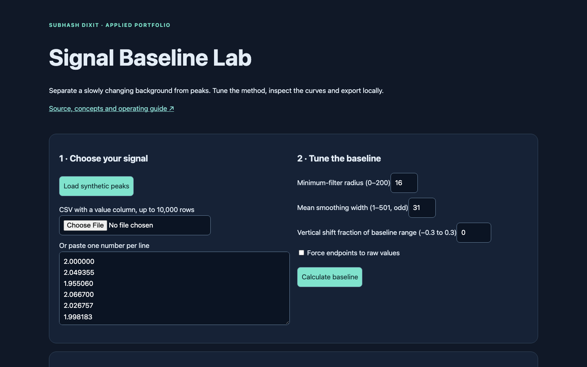
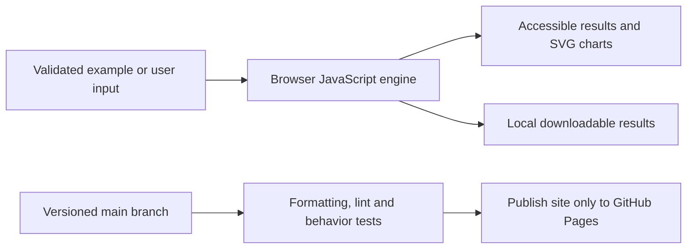
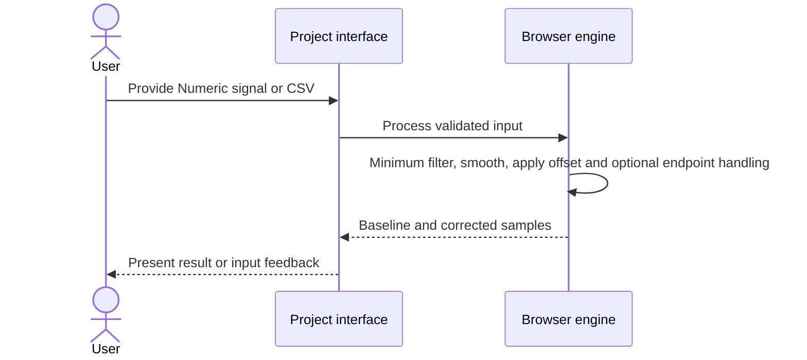
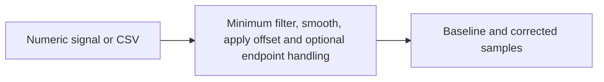

# Signal Baseline Lab

## 1. Project overview

Interactive signal baseline estimation with CSV import, inspectable filters, plots and local export.

[Live demo](https://subhashdixit.github.io/signal-baseline-lab/) · [Source repository](https://github.com/subhashdixit/signal-baseline-lab)



## 2. Motivation and problem statement

### Objective

Estimate an inspectable background trend and subtract it from a numeric signal.

### Problem statement

A drifting baseline can hide peaks, and filter settings can distort what remains.

### Motivation

Showing raw, baseline, and corrected curves together makes preprocessing choices auditable.

## 3. Solution and scope

**Inputs** — Numeric signal or CSV. **Outputs** — Baseline and corrected samples.

### What the finished application does

- Paste a numeric signal, upload a value-column CSV or start with reproducible synthetic peaks.
- Adjust minimum-filter radius, smoothing width, vertical shift and optional endpoint restoration.
- Compare raw, estimated-background and corrected curves; export every observation.

## 4. Quick start and usage

### Use the application step by step

1. Open the live application. Read the input labels and scope panel.
2. Start with the included example to understand the output.
3. Replace it with your own supported input. Files are processed locally unless you explicitly choose a server feature and consent to it.
4. Run the analysis and inspect the visual output together with its limitations.
5. Export your results when the tool offers a download. Keep your own copy; a browser tab is not a durable data store.

## 5. High-level architecture

### Architecture and data flow



HTML provides the accessible page structure, CSS handles responsive layout, and ES modules separate calculation from user interaction. Pure calculation functions can run in Node tests without a browser. SVG charts scale with the screen; they use explicit axes, labels and legends. CSV exports escape spreadsheet formula prefixes in text cells.

## 6. End-to-end request workflow



## 7. Data sources, inputs, and outputs

| Input | Processing | Output |
| --- | --- | --- |
| Numeric signal or CSV | Minimum filter, smooth, apply offset and optional endpoint handling | Baseline and corrected samples |

### Data provenance and attribution

Original Baseline_Creation_Tool source retained. The default 400-observation example is a deterministic synthetic trend with two Gaussian peaks and sinusoidal perturbation; it is not an experiment or a measured accuracy benchmark.

## 8. Data flow and ETL pipeline



## 9. Low-level design and interfaces

Implementation entry points are [`site/index.html`](<site/index.html>), [`site/app.js`](<site/app.js>), [`site/engine.js`](<site/engine.js>).

## 10. Concepts and algorithms

### Concepts, algorithms and interpretation

#### Rolling minimum → smooth background → subtraction

For observation i, take the minimum of values from i−r to i+r, clipped to valid indices. This rejects positive peaks narrower than the window. Average these minima in an odd-width centered window. Shift by a chosen fraction of the smoothed curve range. Finally corrected[i] = raw[i] − baseline[i].

For [1,4,2,5,3], radius 1 and width 1 produce baseline [1,1,2,2,3] and corrected [0,3,0,3,0]. An edge-aware average uses only actual neighboring samples, avoiding the old implementation’s zero-padding edge artifact. The retained original helper allows comparison.

A larger radius treats wider structures as peaks but may underestimate a changing background. More smoothing reduces jaggedness but can flatten real background changes. This centered algorithm uses future neighbors, so it is an offline analysis tool, not a causal online filter. Negative corrected values are kept, rather than clipped to make plots look better.

#### Evaluation

No predictive accuracy is claimed: this is a filter, not an ML model. Check background-only regions, known calibration standards and sensitivity to window settings. If the true baseline is independently known, compute error against that reference; a visually pleasing curve is not evidence of correctness.

## 11. Technology choices and dependencies

- **HTML, CSS, and JavaScript**. Serve a static browser interface with inspectable rendering and validation.

[Dependency versions and runtime rationale](DEPENDENCIES.md)

## 12. Training, inference, and evaluation

Review behavior using the checked-in fixtures and assertions. This application has no project-trained model benchmark.

Validation code is available in [`tests/engine.test.js`](<tests/engine.test.js>).

## 13. Limitations and data handling

### Practical limits

Use 3–10,000 finite samples, magnitude at most 1e12. Radius 0–200, odd smoothing width 1–501 and shift fraction ±0.3 are enforced. Unit spacing is assumed; irregularly sampled signals should be resampled first. Broad/negative peaks and steep background changes can violate the envelope assumption. Endpoint forcing is an explicit optional distortion.

The test suite checks calculation contracts and invalid inputs. It cannot establish that an input dataset is representative, that a heuristic is scientifically correct for every domain, or that a result is suitable for an automated consequential decision. Read the original source alongside the maintained browser implementation when comparing behavior.

## 14. Installation and local setup

### Run locally from scratch

Install Node.js 22 and Python 3 for a local static HTTP server. Python is not a production backend for this app.

```bash
git clone https://github.com/subhashdixit/signal-baseline-lab.git
cd signal-baseline-lab
npm ci
npm test
npm run lint
npm run format
npm run check
python3 -m http.server 8000 --directory site
```

Open http://localhost:8000. Use HTTP rather than double-clicking HTML so that module imports and local data fetches work consistently. No production API secret belongs in `site/`.

### Local dependency installation

The maintained app is HTML/CSS/JavaScript and needs no Python packages. `requirements.txt` documents this; install development tools with `npm ci` using the pinned Node/npm versions. See [DEPENDENCIES.md](DEPENDENCIES.md). Original prototype requirements are preserved at `archive/prototype-requirements.in` where present; they are not the supported install command.

## 15. Repository structure

### Coding structure

```text
site/
  index.html       # accessible application interface
  styles.css       # responsive design
  app.js           # interface orchestration
  engine.js        # validated calculations; no DOM dependency
  ui.js            # chart, CSV and download helpers
tests/             # behavior and boundary cases
.github/workflows/pages.yml
archive/           # original README and retired workflows where present
```

Original source files, notebooks and historical artifacts remain in the repository for comparison. The release publishes only `site/`; old source directories and datasets are not automatically exposed by the application.

## 16. Deployment and operations

### CI/CD and deployment

CI means continuous integration: each pull request and main-branch push installs exact lockfile dependencies, checks formatting, lints JavaScript, runs meaningful behavior tests and checks module syntax. A failed check stops publishing. CD means continuous deployment: after the required `Build and test` check succeeds on `main`, GitHub Actions uploads `site/` and GitHub Pages serves it over HTTPS.

The workflow uses pinned action revisions, minimal permissions and a protected main branch. Publishing jobs need Pages/OIDC permissions; test jobs only read source. Feature branches are deleted after merge. Static Pages hosting needs no always-running Python process, but cannot hide secrets, host a Flask process or provide durable server storage.

To set up a fork, enable GitHub Pages with **GitHub Actions** as its source and allow the repository's workflow to run. Repository Settings → Pages shows the deployment URL. If renaming the repository, update the README URL and any absolute links; application resources use relative paths. Check Actions logs if publishing fails.

#### Release, monitoring and rollback

A commit identifies exactly which source was deployed. Inspect the Actions deployment and test results before sharing the link. After publishing, open the page, run its example and check exports; a successful HTTP response alone is not a functional test. For rollback, revert the faulty merge in a new PR, pass checks, and merge the revert. This triggers the same reproducible publishing process. Avoid force-pushing protected main or deleting history. Browser caches can retain an older asset briefly; refresh after a deployment.

#### Docker and alternatives

Docker packages code and dependencies into a reproducible runtime. This static app does not require a container: Pages serves the same versioned files directly, with less operating work and no container cold starts. A container becomes useful if adding a Python backend; then secrets, patches, resource costs and persistent storage require separate management.

## 17. License, credits, and support

[Repository code license](LICENSE). Report reproducible issues through [GitHub Issues](https://github.com/subhashdixit/signal-baseline-lab/issues).
